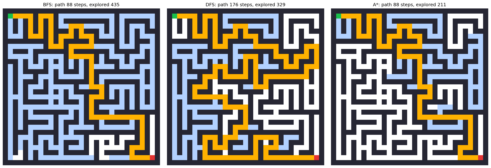
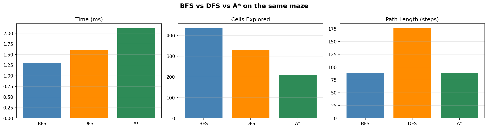
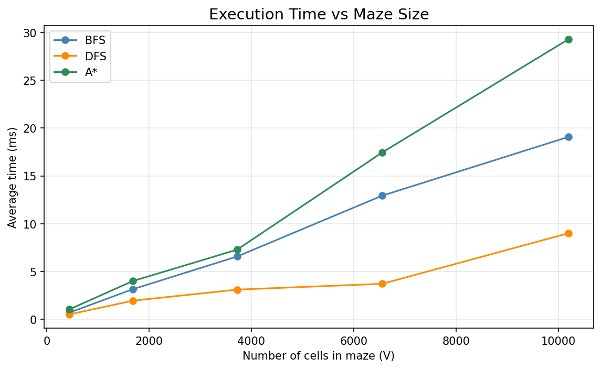

# Maze Solver 🧩

A Python project that generates mazes and solves them using pathfinding algorithms, with visualization of the paths found and a performance comparison of the algorithms.

## Files
- `maize_solver.ipynb` – Main Jupyter notebook with the code, outputs and graphs
- `paths.png` – Mazes with the solution paths drawn
- `comparison.png` – Comparison of the algorithms
- `performance.png` – Execution time vs maze size

## How to Run
1. Clone the repository: git clone https://github.com/SHUB-SOUCE/maze_solver.git
2. Install the libraries: pip install numpy matplotlib jupyter
3. 3. Open `maize_solver.ipynb` in Jupyter Notebook or VS Code and run all the cells.

## Results

## Tech Used
Python, NumPy, Matplotlib, Jupyter Notebook
